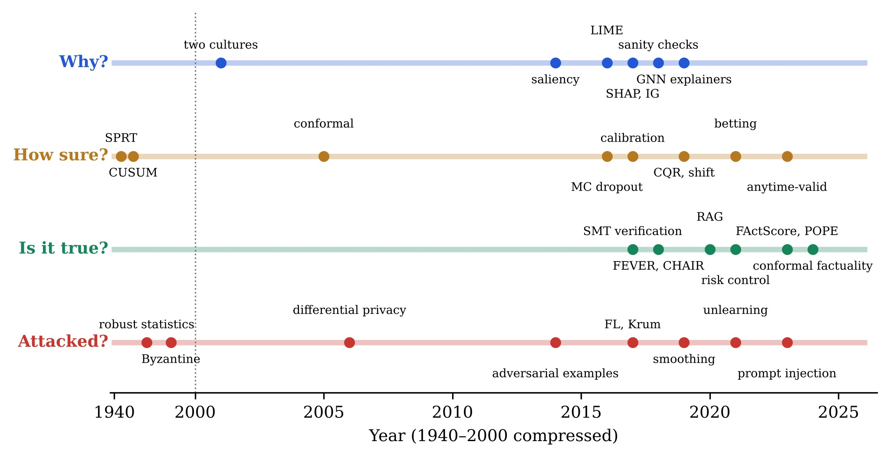
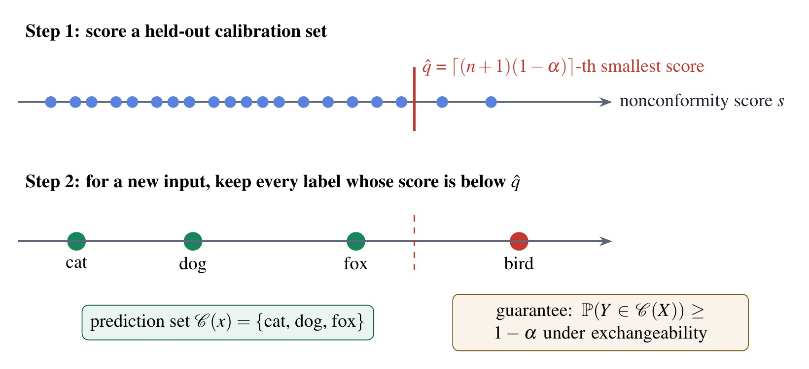
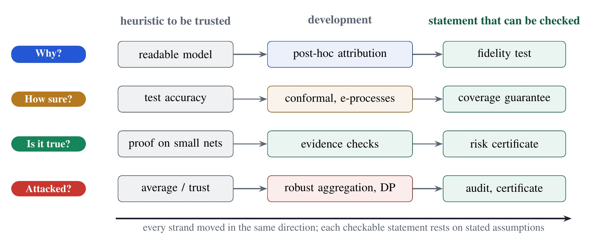

::: {custom-style="PaperTitle"}
Trustworthy artificial intelligence for smart systems: From explainability and uncertainty to verification and resilience
:::

::: {custom-style="PaperAuthors"}
Quang-Vinh Dang^1\*^
:::

::: {custom-style="PaperAffil"}
^1^British University Vietnam, Hung Yen, Vietnam
:::

::: {custom-style="PaperCorr"}
^\*^Corresponding author: dqvinh87@gmail.com
:::

::: {custom-style="AbstractHead"}
Abstract
:::

::: {custom-style="AbstractBody"}
Machine learning now raises alarms on bridges, flags intrusions in networks, filters social media and drives conversational agents. When such a system issues a decision, an engineer must answer four questions before acting on it: why was the decision made, how sure is the system, is the output true, and could the system have been manipulated? This keynote paper reviews how the research community learned to ask these questions, in that order, and how each answer grew from a simple solution, through a documented failure, to the methods available today. For explainability, the path runs from interpretable models through post-hoc attribution methods to tests of explanation fidelity and explanations for graph neural networks under heterophily. For uncertainty, it runs from held-out test accuracy through calibration and Bayesian approximations to distribution-free conformal prediction and anytime-valid sequential testing based on betting. For verification, it runs from formal proofs about small networks through evidence-based checking of generated content to statistical risk control. For resilience, it runs from robust statistics and Byzantine agreement through adversarial examples, robust federated aggregation and differential privacy to auditable machine unlearning and the defence of language-model agents against prompt injection. Along each path the paper situates the author's published contributions, including heterophily-aware explainable bot detection, uncertainty-aware intrusion detection, real-time hallucination correction for vision-language models, Byzantine-robust federated learning, anytime-valid certificates for machine unlearning and compositional attack-path scoring. Simple simulations illustrate the central ideas. A common pattern emerges: in every strand the field moved from a heuristic that must be trusted to a statement that can be checked, and each such statement holds only under assumptions that deserve to be reported as carefully as the results. The paper closes with open problems relevant to smart infrastructure in Vietnam.
:::

::: {custom-style="Keywords"}
***Keywords:** Conformal prediction, explainability, federated learning, sequential testing, uncertainty quantification*
:::

# 1. Introduction

Consider a structural health monitoring system on a highway bridge. Accelerometers on the deck feed a model that, one morning, raises an alarm: possible damage at the second span. The engineer on duty must decide whether to close a lane and dispatch an inspection crew. Before acting, a careful engineer will ask four questions. *Why* did the system raise the alarm, which evidence drove it? *How sure* is it, and how often are such alarms wrong? *Is the claim true*, can it be checked against something independent of the model? And could the alarm, or its absence, be the result of a faulty sensor, a poisoned model update or a deliberate attack?

The same four questions arise for an intrusion detection system that blocks a flow, a bot detector that suspends an account, or a language-model agent that sends an email on a user's behalf. They correspond to four strands of research usually grouped under the label *trustworthy artificial intelligence (AI)*: explainability, uncertainty quantification, verification, and resilience against attack and privacy leakage. Policy documents such as the European Commission's ethics guidelines [@hleg2019], the National Institute of Standards and Technology (NIST) AI Risk Management Framework [@nist2023] and the European Union AI Act [@euaiact2024] list these properties as requirements; they do not, however, say how to achieve them.

Surveys of each strand exist, and they tend to present it as a catalogue of techniques. This paper takes a different route. It tells each strand as a story, starting from the simplest solution a practitioner would try, showing why that solution failed, and following the developments that repaired the failure up to the present. The order of the four strands is itself part of the story: each question became urgent because the answer to the previous one was not enough. A perfectly faithful explanation of a wrong prediction is still a wrong prediction; a well-calibrated probability says nothing about whether a generated sentence is true; and every guarantee can be broken by an adversary who controls part of the data.

{width=100%}

The contributions of this keynote paper are threefold. First, it gives a narrative review of the four strands, with the key formulas that mark each step (Section 3), and a timeline of the milestones (Figure 2). Second, it positions the author's published work within those narratives, stating what each contribution adds and what it does not solve. Third, it identifies a pattern common to all four strands, the move from heuristics to checkable statements, and derives from it a list of open problems for smart systems (Section 4).

# 2. Materials and Methods

This is a narrative review rather than a systematic one. Literature was selected in three steps. First, for each of the four questions, the foundational papers that introduced the simple solution and the papers that documented its failure were identified from the author's teaching and research notes and from the reference lists of recent surveys [@ji2023; @angelopoulos2023; @ramdas2023]. Second, the development of each strand was traced forward through highly cited follow-up work to the present, preferring papers that introduced a new guarantee or a new evaluation principle over incremental improvements. Third, the bibliographic details of every cited work were checked against the publisher's record or the Crossref database.

The author's own contributions were drawn from his published and in-press papers. Their descriptions, equations and reported numbers were taken from the published versions and the accompanying source code. Work that has not yet been accepted for publication is mentioned in Section 4 only as ongoing work, without numerical claims and without being listed as a reference, in line with the guidelines of this conference.

Fourteen figures illustrate the central ideas. Figures 1, 3, 4, 6, 8, 9 and 11–14 are schematic diagrams drawn for this paper. Figure 2 is a timeline compiled from the cited literature. Figures 5, 7 and 10 are small simulations written for this paper in Python with NumPy; their settings are stated in the captions, and they are intended to show the shape of a phenomenon, not to benchmark methods.

# 3. Results

{width=100%}

## 3.1. Why? From readable models to explanations that can be tested

**The simple solution: a model a person can read.** The first answer to "why?" was to use models whose structure is the explanation: rules, decision trees, scorecards and linear models. Early intrusion detection followed this pattern, building a statistical profile of each user and raising alarms through explicit rules on deviations from that profile [@denning1987]. A security analyst could read the rule that fired.

**Why it was not enough.** Breiman's essay on the "two cultures" of statistical modelling documented that algorithmic models such as random forests and neural networks often predict considerably better than the interpretable data models statisticians preferred [@breiman2001]. The pursuit of accuracy pushed practice towards black boxes, and the question changed: can we explain a model that was not designed to be read?

**Development: post-hoc explanation.** A decade of methods answered with attributions, scores that say how much each input feature contributed to a prediction. Gradient saliency [@simonyan2014] scores feature $i$ by the sensitivity of the class score $f_c$,

$$S_i(x)=\left|\frac{\partial f_c(x)}{\partial x_i}\right|.$$

Local interpretable model-agnostic explanations (LIME) fit a simple surrogate $g$ from a class $G$ to the model $f$ on samples weighted by their proximity $\pi_x$ to the input, with a complexity penalty $\Omega$ [@lime2016]:

$$g^\star=\arg\min_{g\in G}\ \mathcal{L}(f,g,\pi_x)+\Omega(g).$$

Integrated gradients add an axiom, completeness: attributions sum to the difference between the prediction at $x$ and at a baseline $x'$ [@sundararajan2017],

$$\mathrm{IG}_i(x)=(x_i-x'_i)\int_0^1\frac{\partial f\big(x'+t(x-x')\big)}{\partial x_i}\,dt .$$

Shapley additive explanations (SHAP) borrow the Shapley value from cooperative game theory, the unique attribution satisfying a set of fairness axioms [@lundberg2017]:

$$\phi_i=\sum_{S\subseteq F\setminus\{i\}}\frac{|S|!\,(|F|-|S|-1)!}{|F|!}\Big[f(S\cup\{i\})-f(S)\Big].$$

Each step added a property its predecessor lacked: locality, completeness, then a principled division of credit.

**The crisis: explanations can be wrong, or gamed.** Two results changed how explanations are judged. Adebayo et al. showed that several popular saliency methods produce nearly the same maps for a trained network and for a network with randomised weights; such maps cannot be explaining what the model learned [@adebayo2018]. Slack et al. built classifiers that behave in a discriminatory way on real inputs while presenting innocuous LIME and SHAP explanations, because those methods query the model on perturbed inputs that an adversarial model can recognise [@slack2020]. The lesson is that an explanation is itself a claim about the model and needs a test, for example a randomisation check or a fidelity measure that removes the highlighted evidence and observes whether the prediction changes. Rudin went further and argued that for high-stakes decisions one should prefer models that are interpretable by design [@rudin2019].

![Figure 3. (a) The sanity-check idea [@adebayo2018]: if randomising the model does not change the saliency map, the map is not explaining the model. (b) Heterophily in adversarial graphs: a bot connects mostly to humans, so averaging over neighbours hides it and a neighbourhood-based explanation misleads (schematic).](dg02.jpg){width=100%}

**The present: explaining relational systems.** Many smart systems are graphs: sensors connected by physical proximity, devices by network flows, accounts by follower relations. Graph neural networks update the representation $h_v$ of each node from its neighbourhood $\mathcal{N}(v)$,

$$h_v^{(\ell+1)}=\sigma\Big(W^{(\ell)}\cdot\operatorname{AGG}\big\{h_u^{(\ell)}:u\in\mathcal{N}(v)\cup\{v\}\big\}\Big),$$

and GNNExplainer explains a prediction by finding a small subgraph and feature subset that maximise mutual information with the prediction [@ying2019]. Neighbourhood aggregation, however, rests on an assumption of *homophily*: that connected nodes tend to share a label. Many real graphs are heterophilous, and in adversarial settings this is deliberate. Fraudsters, bots and intruders connect to many normal nodes so that their neighbourhoods look normal, which degrades standard graph neural networks [@zhu2020]. In such graphs both the prediction and the explanation ("the neighbours look normal") mislead.

**Our contribution.** XHBot addresses this setting for social bot detection [@own2026xhbotexplainableheterophily]. It combines four ideas. A spectral refinement step learns, for each edge, a label-free mismatch score $E(u,v)=\sigma\big(W[x_u\Vert x_v\Vert(x_u-x_v)^2]+b\big)$ and softly down-weights edges whose score exceeds a threshold, since edges between dissimilar nodes carry high-frequency energy in the sense of the graph Dirichlet energy $\sum_{(u,v)}(f_u-f_v)^2$. A three-channel layer combines smoothing over the refined graph, max-pooling over the raw graph, which preserves anomalous signals instead of averaging them away, and a self-identity channel, fused by per-node attention. A disentangling objective separates a node's behavioural code from its social-position code. Finally, explanations are produced at two levels, a sparse edge mask that preserves the prediction and a community-level summary, and are evaluated by fidelity, the test that the crisis above called for. In ablations, the heterophilic channel contributed most to performance. Earlier, our work on intrusion detection had used explainability both to understand detector decisions and to improve detectors by selecting features that the explanations showed to be informative [@own2020understandingdecisionmachine; @own2021improvingperformanceintrusion].

![Figure 4. Pipeline of XHBot [@own2026xhbotexplainableheterophily]: spectral edge refinement, a three-channel heterophily-aware layer, disentangling of behaviour from social position, and two-level explanations. The raw graph is kept for the max-pooling channel.](dg03.jpg){width=100%}

**Hand-off.** An explanation tells an operator which evidence the model used. It does not tell the operator whether this particular output is correct, or how often outputs like it are wrong. Operators of our explained intrusion detectors asked exactly that next question.

## 3.2. How sure? From test accuracy to guarantees that survive peeking

**The simple solution: trust the test score.** The default answer to "how sure?" is the accuracy on a held-out test set. This silently assumes that deployment data are drawn from the same distribution as test data. In security this assumption fails by design: Sommer and Paxson described the *closed-world* problem of anomaly detection, in which detectors are evaluated on data that cannot contain tomorrow's attacks [@sommer2010], and Arp et al. found sampling bias and laboratory-only evaluation among the most common pitfalls of machine learning in security research [@arp2022]. The same observation motivated our work on transferring knowledge between intrusion detection datasets, since a detector trained on one network must be adapted before it can be trusted on another [@own2023learningtransferknowledge].

**Next: let the model state its confidence.** A classifier's softmax output $\hat p=\max_k\operatorname{softmax}(z)_k$ can be read as a confidence. Classical models were often reasonably calibrated [@niculescu2005], but Guo et al. showed that modern deep networks are systematically overconfident [@guo2017]. The gap is measured by the expected calibration error over confidence bins $B_b$,

$$\mathrm{ECE}=\sum_b\frac{|B_b|}{n}\,\big|\operatorname{acc}(B_b)-\operatorname{conf}(B_b)\big|,$$

and is largely removed by temperature scaling, $\hat p=\operatorname{softmax}(z/T)$ with a single parameter $T$ fitted on validation data [@guo2017] (Figure 5a). Calibration, however, is fitted on familiar data. Networks still assign high confidence to inputs unlike anything seen in training [@nguyen2015], which motivated baselines for detecting such out-of-distribution inputs [@hendrycks2017].

**Development: separating noise from ignorance.** Treating the model weights $\theta$ as uncertain yields, by the law of total variance, a decomposition of predictive uncertainty into an aleatoric part, noise inherent in the data, and an epistemic part, ignorance that more data could remove [@kendall2017]:

$$\operatorname{Var}[y\mid x]=\underbrace{\mathbb{E}_\theta\operatorname{Var}[y\mid x,\theta]}_{\text{aleatoric}}+\underbrace{\operatorname{Var}_\theta\,\mathbb{E}[y\mid x,\theta]}_{\text{epistemic}}.$$

Monte Carlo dropout [@gal2016] and deep ensembles [@lakshminarayanan2017] made the epistemic term practical. A large benchmark then showed that the quality of all these estimates degrades under distribution shift, and none of them carries a guarantee [@ovadia2019]. Our work on intrusion detection used such uncertainty measures as a routing signal: confident predictions are acted upon, uncertain ones are escalated to an analyst or a second model, which improves overall detection performance [@own2026utilizinguncertaintymeasures].

{width=100%}

**The guarantee: conformal prediction.** Conformal prediction replaces modelling assumptions by a single assumption about the data, exchangeability [@vovk2005]. In its split form [@papadopoulos2002], held-out calibration examples $(x_i,y_i)$, $i=1,\dots,n$, are scored by a nonconformity score such as $s_i=1-\hat p_{y_i}(x_i)$. Let $\hat q$ be the $\lceil (n+1)(1-\alpha)\rceil$-th smallest score. The prediction set for a new input is $\mathcal{C}(x)=\{y: 1-\hat p_y(x)\le\hat q\}$. If calibration and test points are exchangeable, then

$$1-\alpha\ \le\ \mathbb{P}\big(Y\in\mathcal{C}(X)\big)\ \le\ 1-\alpha+\frac{1}{n+1},$$

because the rank of the test score among the $n+1$ scores is uniformly distributed [@angelopoulos2023]. No assumption is made about the model. Figure 5b shows the guarantee at work and also its nature: it holds on average over calibration draws, and a single small calibration set can under-cover.

{width=100%}

The two decades that followed extended this guarantee in several directions. Lei et al. established distribution-free predictive inference for regression [@lei2018]. Conformalised quantile regression made intervals adapt to local noise [@romano2019], and adaptive prediction sets made classification sets grow where the classifier is unsure [@romano2020]. Weighting calibration scores by a likelihood ratio handles covariate shift [@tibshirani2019]. Adaptive conformal inference maintains long-run coverage under drift by updating the level online, $\alpha_{t+1}=\alpha_t+\gamma(\alpha-\mathrm{err}_t)$ [@gibbs2021], and Barber et al. bounded the coverage loss when exchangeability fails [@barber2023]. Our earlier work applied kernel-based nonconformity scores to botnet detection, giving set-valued outputs with a stated error rate [@own2024kernelmethodsconformal].

**Monitoring over time: from Wald to betting.** A monitoring system tests the same hypothesis, "the structure is healthy", at every epoch for years. A test at level $\alpha$ repeated at every look accumulates false alarms; with enough looks, a false alarm is almost certain (Figure 7a). The classical answers are Wald's sequential probability ratio test [@wald1945], which stops when the likelihood ratio $\Lambda_t=\prod_{s\le t}p_1(X_s)/p_0(X_s)$ exceeds $1/\alpha$, and Page's cumulative sum (CUSUM) procedure for change detection [@page1954]. Both need the pre- and post-change distributions to be specified.

The modern answer is testing by betting [@shafer2021; @ramdas2023]. A forecaster bets against the null hypothesis that observations $X_s\in[0,1]$ have mean at most $\mu_0$, choosing each bet $\lambda_s$ before seeing $X_s$. The forecaster's wealth

$$W_t=\prod_{s\le t}\big(1+\lambda_s(X_s-\mu_0)\big)$$

is a non-negative supermartingale under the null, and Ville's inequality gives, for all stopping rules at once,

$$\mathbb{P}_{H_0}\big(\exists\,t:\ W_t\ge 1/\alpha\big)\le\alpha.$$

The monitor may look at the data every hour and stop whenever it likes: the false-alarm budget holds for the whole monitoring life, without a parametric model (Figure 7). Confidence sequences built on the same principle give anytime-valid estimates of means [@howard2021; @waudby2024], and e-values have become a general language for such evidence [@vovkwang2021; @grunwald2024].

{width=100%}

**Hand-off.** Calibrated probabilities, conformal sets and e-processes quantify how often a model errs. For a generative model that produces a sentence or a caption, the operator needs something more direct: is this particular output true?

## 3.3. Is it true? From proofs about networks to guarantees about outputs

**The first answer: prove properties of the network.** Formal verification asks a yes-or-no question for every input in a region, for example whether all inputs within distance $\varepsilon$ of $x_0$ receive the same label,

$$\forall x\in\mathcal{B}_\infty(x_0,\varepsilon):\ \arg\max_k f_k(x)=y_0\ ?$$

Satisfiability modulo theories (SMT) solving made this feasible for networks with rectified linear units [@katz2017], layer-by-layer search addressed safety of image classifiers [@huang2017], and bound propagation combined with branch-and-bound scaled verification considerably further [@wang2021bcrown]. These methods prove local properties of moderately sized networks; they cannot establish that a sentence produced by a language model is factually correct.

{width=100%}

**The second answer: check outputs against evidence.** A parallel line of work checks the output instead of the network. The FEVER benchmark framed fact verification as retrieving evidence and labelling a claim as supported, refuted or lacking information [@fever2018]. The CHAIR metric measured object hallucination in image captions against annotations [@rohrbach2018]. Retrieval-augmented generation conditioned generation on retrieved passages [@lewis2020]. SelfCheckGPT detected hallucinations through inconsistency among sampled answers [@selfcheck2023], FActScore split generations into atomic facts and scored the share supported by a knowledge source [@factscore2023], and POPE probed vision-language models with yes-or-no questions about object presence [@pope2023]. A survey documents how hallucination became a research field of its own [@ji2023]. These methods detect and score unsupported content; most give no guarantee about how often an accepted output is still wrong.

**The present: guarantees on what is said.** Selective prediction lets a model abstain when a confidence score falls below a threshold, trading coverage, the share of inputs answered, for risk among the answered ones [@geifman2017]. Risk control turns this trade-off into a guarantee: choose the threshold $\hat\lambda$ on calibration data so that, with high probability,

$$\mathbb{E}\big[\ell\big(Y,\mathcal{C}_{\hat\lambda}(X)\big)\big]\le\alpha$$

for a bounded loss $\ell$ [@bates2021; @angelopoulos2024crc]. Conformal factuality applies the idea to text: sub-claims of a generated answer are removed until the remainder is factual with probability at least $1-\alpha$ [@mohri2024]. The price of such guarantees is abstention, which raises the question of how much can be answered rather than refused.

**Our contribution.** CMVKG-Guard verifies a vision-language model while it generates [@own2026realtimehallucination]. For each proposed token it builds three scores: a visual score from the attention mass on the token's image region and a contrastive image-text similarity, a knowledge-graph score from the most confident path in a per-query multimodal knowledge graph, and a reasoning score from multi-hop checks. A weighted combination $\Omega(t_i)=w^\top[S_{\mathrm{vis}},S_{\mathrm{kg}},S_{\mathrm{reason}}]$ is compared with a threshold that tightens with the generation step, to stop hallucinations from compounding. Flagged tokens are replaced through a look-ahead beam search that mixes the model's likelihood with the graph's. The method wraps the generation loop without retraining. On LLaVA-1.5 it raised the F1 score on POPE from 82.1 to 91.2 and reduced the CHAIR hallucination rate from 22.0% to 3.5%, with about 12 ms of overhead per token (Table 2). The same paper reports its limitations: performance is sensitive to the base threshold, and over-correction caused by missed object detections accounts for most remaining errors. CMVKG-Guard is a detector and corrector, not a guarantee, which is why our ongoing work combines its correction step with the risk-control framework above (Section 4).

![Figure 9. Token-level verification and correction in CMVKG-Guard [@own2026realtimehallucination]. Three verification layers score each proposed token; tokens below a step-aware threshold are replaced through a look-ahead beam search guided by the knowledge graph.](dg06.jpg){width=100%}

**Hand-off.** All the guarantees so far assume that the data, the calibration set and the participants are honest. The final question drops that assumption.

## 3.4. Attacked? From robust statistics to auditable systems

**The simple solution: statistics that tolerate bad data.** Robust statistics began with Huber's observation that a single arbitrary outlier can move the sample mean anywhere, whereas estimators such as the median tolerate a large fraction of contaminated data [@huber1964]. In distributed computing, the Byzantine generals problem showed that agreement despite $f$ arbitrarily faulty participants requires at least $n\ge 3f+1$ participants [@lamport1982]. These two ideas, bounded influence and tolerance of liars, reappear in every modern defence.

**Development: inputs designed to fool the model.** Szegedy et al. found that imperceptible perturbations change the predictions of neural networks [@szegedy2014], and the fast gradient sign method made such adversarial examples cheap to compute [@goodfellow2015]:

$$x'=x+\varepsilon\,\operatorname{sign}\big(\nabla_x\mathcal{L}(f(x),y)\big).$$

Adversarial training with projected gradient descent trains on the worst case within a perturbation budget, $\min_\theta\mathbb{E}\big[\max_{\|\delta\|\le\varepsilon}\mathcal{L}(f_\theta(x+\delta),y)\big]$ [@madry2018]. An arms race followed in which many proposed defences were broken by stronger attacks [@carlini2017], several of them because they obscured gradients rather than removing vulnerabilities [@athalye2018]. Randomised smoothing then provided certificates: a classifier smoothed with Gaussian noise of scale $\sigma$ cannot be changed by any perturbation within radius

$$R=\frac{\sigma}{2}\Big(\Phi^{-1}(\underline{p_A})-\Phi^{-1}(\overline{p_B})\Big),$$

where $\underline{p_A}$ and $\overline{p_B}$ bound the probabilities of the top two classes [@cohen2019]. The arc mirrors Section 3.2: from heuristics to certificates.

**Many participants: federated learning and its liars.** Federated learning trains a shared model while data stay local; the server averages client models, $w_{t+1}=\sum_k\frac{n_k}{n}w^{(k)}_{t+1}$ [@mcmahan2017]. The mean is exactly the estimator Huber warned about. Robust aggregation rules replace it: Krum selects the update closest to its neighbours [@blanchard2017], and coordinate-wise medians and trimmed means come with statistical error rates [@yin2018]. Figure 10 shows the difference in a simple simulation. Robust rules, however, do not stop a participant who implants a backdoor through updates that look statistically normal [@bagdasaryan2020]. FLTrust responded by bootstrapping trust from a small clean dataset held by the server [@cao2021fltrust].

{width=75%}

**Our contribution: FORTRESS-FL.** In next-generation networks, the participants in federated learning are operators that share a model but not data, and do not fully trust each other. FORTRESS-FL combines the historical ideas above into one protocol [@own2026fortressflbyzantine]. Operators first commit to their updates with Pedersen commitments, so no operator can adapt its update to the others'. A spectral step builds a cosine-similarity graph of updates and separates an outlying cluster using the normalised Laplacian. Each operator carries a reputation updated as an exponential moving average of how close its update is to the honest consensus. Updates are then aggregated with reputation weights, and Gaussian noise is added for differential privacy. The design targets settings with fewer than one third Byzantine operators, the bound inherited from Lamport et al. Our earlier FedFairGNN work combined federated graph learning with privacy and fairness constraints for fraud detection [@dang2026fedfairgnn].

![Figure 11. (a) Federated learning with honest and Byzantine operators. (b) One aggregation round of FORTRESS-FL [@own2026fortressflbyzantine]: commitment, spectral filtering, reputation weighting, and differentially private aggregation.](dg07.jpg){width=100%}

**Privacy, and proving that something was forgotten.** Differential privacy bounds what any single record can reveal: a mechanism $M$ is $(\varepsilon,\delta)$-differentially private if, for all datasets $D,D'$ differing in one record and all sets of outcomes $S$ [@dwork2006],

$$\mathbb{P}[M(D)\in S]\le e^{\varepsilon}\,\mathbb{P}[M(D')\in S]+\delta .$$

Differentially private stochastic gradient descent clips per-example gradients and adds Gaussian noise [@abadi2016]. Membership inference attacks showed that ordinary models leak whether a record was used in training [@shokri2017]. Privacy auditing then planted known records, called canaries, to measure leakage empirically [@carlini2019; @jagielski2020], eventually from a single training run [@steinke2023]. In parallel, data-protection law created a right to erasure [@gdpr2016], and machine unlearning sought to remove a record's influence without full retraining [@caoyang2015; @bourtoule2021]. We discussed early on what this right means for deployed machine learning [@own2021rightbeforgotten]. One piece remained missing: the data owner cannot inspect the model, and the operator has no incentive to report failure. How can forgetting be verified?

**Our contribution: VOUCH.** VOUCH issues anytime-valid certificates of unlearning by combining the canaries of privacy auditing with the betting e-processes of Section 3.2 [@dang2026vouch]. The verifier creates twin canary records and flips a private coin to decide which twin is trained on, and later forgotten, while the other is never seen. After unlearning, it compares the model's score $s$ on the two twins, $Z_i=\mathbf{1}\{s(M_u,c_i^{\mathrm{in}})>s(M_u,c_i^{\mathrm{ghost}})\}$. If forgetting is exact, $Z_i$ is a fair coin *by the verifier's own randomisation*, with no shadow models and no trust in the provider. The verifier then bets that the attacker's advantage is below a tolerance $\varepsilon$, with wealth $E_t=\prod_{u\le t}\big(1+\lambda_u(p_0(u)-Z_{\pi(u)})\big)$, where the boundary $p_0(u)$ is recentred on the pairs not yet revealed so that the test remains exact under arbitrary dependence between pairs. A certificate is issued when the wealth reaches $1/\alpha$, and a mirror process revokes it if leakage is detected. In experiments, a fixed-sample test used with repeated peeking reached a type-I error of 0.35 while VOUCH remained below $\alpha$; VOUCH needed fewer queries than valid group-sequential baselines; and on standard unlearning benchmarks, models that had not been unlearned were revoked in 16 of 18 runs, while exactly retrained models were certified in all 18 runs at $\varepsilon=0.1$. The paper also states its limits: it certifies the absence of leakage detectable by a declared class of scores on the planted cohort, not the erasure of parameters, and a perplexity filter can identify the canaries.

![Figure 12. Protocol of VOUCH [@dang2026vouch]. Paired canaries and a private coin create an exact null hypothesis under which the verifier bets; a certificate is issued or revoked when the corresponding wealth reaches 1/α.](dg08.jpg){width=100%}

**The newest surface: language-model agents.** Language models that read documents and call tools merge the data channel and the instruction channel. Perez and Ribeiro demonstrated goal hijacking and prompt leaking with instructions such as "ignore previous instructions" [@perez2022]. Greshake et al. showed *indirect* prompt injection, in which the attack hides in a web page, email or document the agent retrieves [@greshake2023]. Zou et al. found adversarial suffixes that transfer across aligned models [@zou2023], and AgentDojo provided a benchmark of attacks and defences for tool-using agents [@debenedetti2024]. Classical input validation does not apply when any text can act as an instruction.

**Our contribution: CAPS.** Component-level vulnerability scores rate each component of a deployment in isolation, whereas attacks on retrieval-augmented and agentic systems are chains, for example an injected document reaching a retriever, then an agent, then a shell. CAPS scores such chains [@own2026capscompositionalattack]. The effective exploitability of a vulnerability is reduced by each mitigation $m$ treated as an independent survival factor, $E_{\mathrm{eff}}=E_{\mathrm{base}}\prod_m\big(1-M(m)\big)$; a path $P$ of $k$ nodes ending in an asset of value $I(v_k)$ receives the score

$$S(P)=10\,I(v_k)\,\alpha^{k-1}\prod_{i=1}^{k}P_{\mathrm{node}}(v_i),$$

with a decay $\alpha<1$ per hop; and candidate mitigations are ranked by how much they lower the score of the worst path. The paper notes its main limitations: exploitability values are expert estimates, and mitigations are assumed to fail independently.

![Figure 13. (a) Indirect prompt injection: an instruction hidden in retrieved content travels through the agent to a tool with real-world effect. (b) CAPS [@own2026capscompositionalattack] scores attack chains rather than isolated components.](dg09.jpg){width=100%}

Table 1 summarises the four narratives, and Table 2 lists the author's contributions discussed in this section.

: Table 1. Four questions, four trajectories.

| Question | Simple solution | Why it failed | Where the field is now |
|---|---|---|---|
| Why? | Interpretable models: rules, trees, scorecards | Lower accuracy than black boxes | Post-hoc attributions with fidelity tests; explanations for graphs under heterophily |
| How sure? | Accuracy on a held-out test set | Distribution shift; overconfidence | Conformal prediction; anytime-valid tests by betting |
| Is it true? | Formal proofs about the network | Limited to small networks and local properties | Evidence-based checking; statistical risk control of outputs |
| Attacked? | Robust statistics; Byzantine agreement | Adversarial examples, backdoors, privacy leakage | Certified robustness; robust federated learning; privacy audits; agent defences |

: Table 2. Published contributions of the author discussed in this paper.

| Question | Work | Main idea | Reported result |
|---|---|---|---|
| Why? | XHBot (2026) | Spectral edge refinement, heterophily-aware channels, two-level explanations | Heterophilic channel contributes most in ablations |
| How sure? | Uncertainty-aware intrusion detection (2026) | Route uncertain predictions to an analyst or a second model | Improved detection performance |
| How sure? | Kernel conformal botnet detection (2024) | Kernel nonconformity scores | Set-valued outputs with a stated error rate |
| Is it true? | CMVKG-Guard (2026) | Token-level three-layer verification and correction | POPE F1 82.1 → 91.2; CHAIR 22.0% → 3.5%; about 12 ms per token |
| Attacked? | FORTRESS-FL (2026) | Commitments, spectral filtering, reputation, differential privacy | Byzantine-robust, privacy-preserving aggregation for multi-operator networks |
| Attacked? | VOUCH (in press) | Paired canaries with betting e-processes | Valid under peeking; revoked 16/18 non-unlearned models |
| Attacked? | CAPS (2026) | Decayed path scoring for attack chains | Ranks mitigations by reduction of worst-path risk |

# 4. Discussion

**A common pattern.** Read side by side, the four narratives share a structure (Table 1, Figure 14). Each began with a heuristic that had to be trusted: a readable model, a test score, a formal proof limited to small networks, an average. Each heuristic failed in a documented way. Each strand then moved towards a statement that an outsider can check: a fidelity test for an explanation, a coverage guarantee for a prediction set, a risk certificate for generated content, an audit of forgetting. The oldest ideas keep returning. Wald's sequential test of 1945 reappears as the e-process that monitors bridges and certifies unlearning; Huber's breakdown point reappears in federated aggregation; Lamport's bound on faulty participants reappears in federated protocols for telecommunications operators. Students entering the field are well served by learning these foundations alongside the newest methods.

{width=100%}

**Domain structure makes guarantees useful.** Distribution-free guarantees are attractive because they assume little, but by assuming little they can say little. In our ongoing (unpublished) work on structural health monitoring, we combine the betting e-processes of Section 3.2 with the physics of vibrating structures: eigenvalue perturbation theory implies that a loss of stiffness can only lower natural frequencies, in directions given by the finite-element model, so the monitor can bet only on evidence of that shape. Similarly, in ongoing work on graph-based bot detection we derive the camouflage level at which averaging over neighbours becomes worse than ignoring the graph. In both cases, knowledge of the domain turns a generic guarantee into a sharper one.

**What did not work.** A trustworthy-AI research programme that reports only successes would itself be untrustworthy. Several of our ongoing studies have produced negative results that shape the agenda. Intrusion detectors that perform almost perfectly within one dataset perform close to chance on another, and a recipe designed for domain invariance did not close the gap. Guarantees that rely on a calibration or commissioning period are only as good as that period: short commissioning windows produce many false alarms. When an abstention-only policy is extended with certified corrections, most of the gain can come from a better correctness score rather than from the corrections themselves. And anytime-valid combinations of evidence can be valid yet powerless at the sample sizes available in practice. Every guarantee in this paper rests on assumptions, such as exchangeability, adequate calibration data, independent units or a declared attacker, and these failures show where the assumptions bite.

**Open problems.** Several problems appear particularly relevant to smart systems. First, most guarantees are marginal, holding on average over a population; operators need conditional guarantees for this bridge or this patient. Second, guarantees should survive drift without long recalibration periods. Third, explanations should carry a certificate of fidelity, not only a visual impression. Fourth, verification of free-form generated text and of agent actions remains largely open beyond yes-or-no questions. Fifth, monitors themselves will become targets of adaptive attackers. Finally, as Vietnam invests in smart cities, energy systems and transport infrastructure, these methods need local data, local evaluation and collaboration between universities and operators, which is an opportunity for institutions such as those represented at this conference.

# 5. Conclusion

Trust in an AI-driven decision can be organised around four questions, asked in the order in which the research community learned to ask them: why, how sure, is it true, and could it have been attacked. For each question, this paper traced the path from a simple solution, through its failure, to the present state of the art, and placed the author's published contributions on that path. The common lesson is that progress came from replacing heuristics that must be trusted with statements that can be checked, and that each such statement is only as reliable as its assumptions. Reporting those assumptions, and the cases in which they fail, is part of building trustworthy systems.
